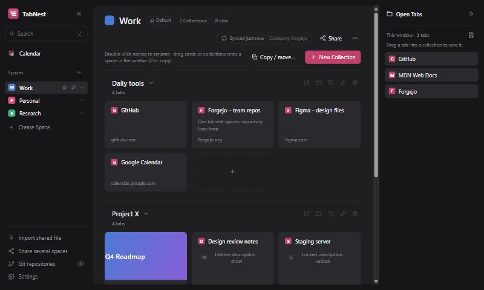
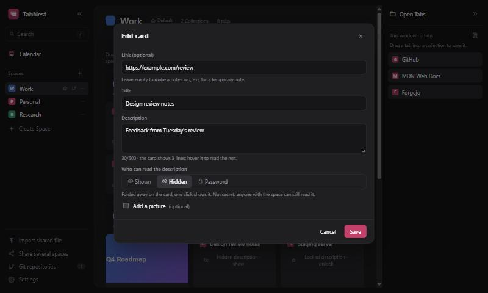
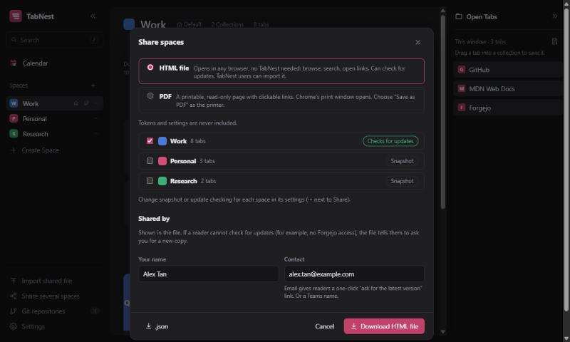
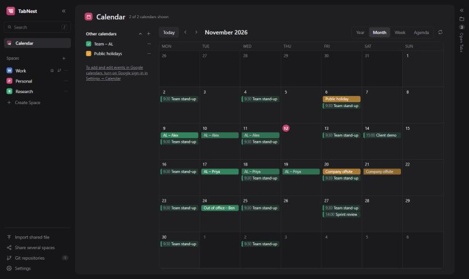
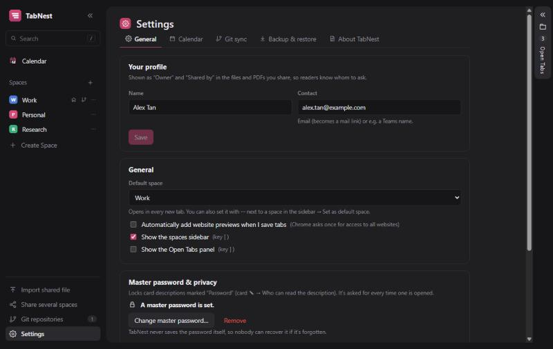
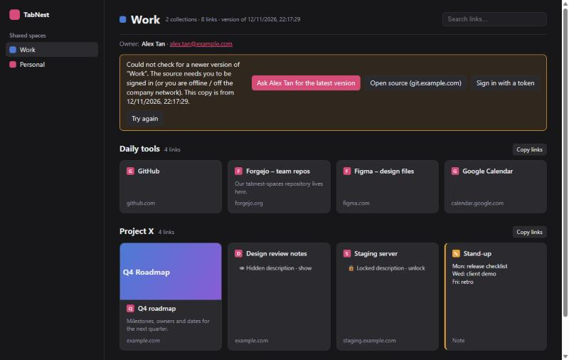
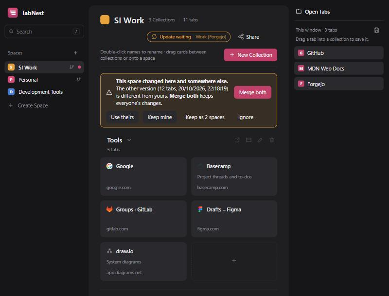

# TabNest

A Toby-style tab manager for Chrome that replaces the new-tab page: **spaces** hold **collections**, which hold **cards**
(saved links and notes). On top of that it has:

1. **Offline sharing.** Export any space (or several) as a single `.html` file or a PDF. Anyone can open the HTML file in a
   browser with **no extension installed**: browse, search, open links, copy links.
2. **Git sync per space.** Each space can sync through its own repository: your company **Forgejo** for work spaces,
   **GitHub** (or GitLab) for personal ones, with an update setting per space: **Auto-pull / Ask me / Ignore**.
3. **A calendar page.** Your Google calendars (add, change and delete events, several accounts), plus view-only iCal links
   (Google, Outlook, holidays) and webmail calendars (CalDAV, e.g. cPanel).
4. **Private card descriptions.** Hide a description until clicked, or lock it with a master password (encrypted, also in
   synced and shared copies), with a screen-lock style auto-hide.
5. **Backup & restore.** All spaces and settings in one file, to move TabNest to another device.

No TabNest server: everything stays in your browser, your git repositories and your Google account.

## Screenshots

**Spaces, collections and cards.** Drag tabs in from the right; each space can sync to its own repo. The 🏠 marks the
default space, and descriptions can be hidden or locked with a password.



| Card editor: who can read the description | Share as an HTML file or PDF |
| --- | --- |
|  |  |
| **Calendar**: linked calendars and your Google accounts | **Settings**: profile, default space, master password, … |
|  |  |
| A shared file opened without the extension | **Merge both** when a space changed on two devices |
|  |  |

## Install (developer mode)

```bash
git clone https://github.com/AvenousLee/TabNestOffline.git
cd TabNestOffline
npm install
npm run build
```

Then in Chrome open `chrome://extensions`, turn on **Developer mode**, click **Load unpacked**, and pick the `dist` folder.
Open a new tab and TabNest appears. Step-by-step instructions (including a ready-made build folder) are in [SETUP.md](SETUP.md).

After changing code, run `npm run build` again and press the reload icon on the TabNest card in `chrome://extensions`.
Always load the same folder: Chrome ties TabNest's saved data to it.

| Command | What it does |
| --- | --- |
| `npm run dev` | Runs the UI as a normal web page at http://localhost:5173/newtab.html, using sample tabs and localStorage. |
| `npm run build` | Type-checks and builds the extension into `dist/`. |
| `npm test` | Unit tests (sync and merge, sharing, calendars, encryption, backup, …). |
| `npm run icons` | Regenerates the PNG icons. |
| `npm run release` | Builds and packs `release/TabNest-v<version>.zip` for a GitHub release (see below). |

## Using it

**Spaces, collections and cards**

- Drag tabs from **Open Tabs** (right) into a collection, or drop on the dashed box to start a new collection.
  The 💾 button saves the whole window as a collection.
- Drag cards to reorder them, move them between collections, or drop them on a space in the sidebar.
- **Note cards:** add a card without a link to keep a quick note.
- Cards can have a picture (upload, paste, image link or the website's own preview) and a description of up to 500 characters.
- Press `/` to search every space. Double-click a space or collection name to rename it.

**Spaces**

- **Reorder** spaces by dragging them in the sidebar; a line shows where they'll go.
- **⋯ next to a space:** *Rename* and *Set as default space*. The **default space** (🏠) opens in every new tab; without a
  choice it's the first space in the list. It's also in *Space settings* and *Settings → General*.
- **Space settings** (⋯ in the space header) has three tabs: **General** (name, colour from the palette, the colour picker
  or a `#hex` / `rgb()` code, default space, delete), **Sync** and **Sharing**.
- **Copy / move collections** to another space (or a new one): the *Copy / move…* button, the copy icon on a collection,
  or drag a collection onto a space in the sidebar (hold **Ctrl** to copy instead of move).

**Layout**

- « and » hide the side panels (or press `[` and `]`). In narrow windows the sidebar becomes an icon strip that slides open.

**Settings** (bottom of the sidebar), in tabs:

| Tab | What's there |
| --- | --- |
| General | Your profile (shown as owner in shared files), default space, website previews, side panels, master password and auto-hide |
| Calendar | Calendar on/off, Google sign-in on/off with its setup guide, client ID, accounts, linked calendars |
| Git sync | Your Git repositories |
| Backup & restore | Download a backup of everything, or restore one |
| About TabNest | Version, credits, source code link, **Check for updates** |

## Private card descriptions

In a card's editor, **Who can read the description**:

- **Shown:** as usual.
- **Hidden:** folded away on the card until clicked. Not secret: anyone with the space can still read it.
- **Password:** encrypted (AES-GCM 256, key from the password with PBKDF2-SHA256), so it's unreadable without the password
  in storage, git, shared files and backups. It's locked with your **master password** (*Settings → General*), which is asked for
  **every time** a description is opened. Shared HTML files can unlock it too, with the password.

Opened descriptions close again by themselves after a chosen time without mouse or keyboard use (5 minutes by default) and,
optionally, when you leave the tab. If that happens while you're editing one, your changes are kept as an encrypted draft and come
back the next time you unlock it.

TabNest never stores the master password itself, only a check value made with it. When you set it you also pick a **recovery picture**
(one of 24) and type a **recovery word**, plus an optional hint. If you forget the password, **Forgot the master password?** shows
your hint; choosing the right picture and typing the word lets you set a new one (locked descriptions are re-locked with it). Without the
password or the picture + word, nobody can open locked descriptions.
Changing the master password re-locks every description locked with the old one.

## Calendar

One **Calendar** page (top of the sidebar) with Year, Month, Week and Agenda views. It can be switched off in
*Settings → Calendar*.

- **Other calendars (view only):** iCal links (Google's secret address, Outlook's published ICS, holidays) and **webmail
  calendars** over CalDAV (address + email login, e.g. cPanel webmail on port 2080). Refreshed every 15 minutes.
- **My calendars:** sign in to one or more **Google accounts**, choose which of their calendars to show, and add, change and
  delete events. Each user creates their own free Google client ID once; the reason and the steps are in TabNest
  (*Settings → Calendar → Open the setup guide*) and in [SETUP.md](SETUP.md#google-sign-in-optional).

Calendar links, webmail passwords and Google sign-ins stay on the device.

## Sharing a space offline

**Share** (top right of a space) downloads `Space name.html`, or opens Chrome's print window to **Save as PDF**.
Send it by email, Teams or a shared drive. Site icons and uploaded pictures are inside the file, so it works offline.

Each space's *Space settings → Sharing* tab decides how its shared file behaves:

- **Snapshot.** A frozen copy.
- **Check for updates.** When opened, the file fetches the latest version of the space and shows
  *"A newer version is available: Show update / Ignore"*. *Save updated file* re-downloads the HTML with the new data.
  The link it checks is the space's git file, or a link you type.

  The check works automatically when the reader can reach the link:
  - **GitHub:** the repo must be public.
  - **Forgejo:** works without login if the repo is readable without login. For **private** repos, readers can click
    **Sign in with a token** in the file and paste their own Forgejo token (Settings → Applications, read access).
    A shared file can't use the browser's normal Forgejo login, so a token is the only way it can sign in. This also needs the
    Forgejo admin to allow cross-site requests in `app.ini`:
    ```ini
    [cors]
    ENABLED = true
    ALLOW_DOMAIN = *
    HEADERS = Content-Type,User-Agent,Authorization
    ```
  - **If the check fails** (no access, offline, CORS not enabled), the file says so and offers:
    **Ask <owner> for the latest version** (a ready-made email, using the name and contact from your profile),
    **Open source** (the file's page on Forgejo/GitHub, for readers who can sign in there), **Sign in with a token**, and **Try again**.

The first time you share a space, your profile becomes its **owner**, and the owner stays with the space in every copy.

People who **do** have TabNest can use **Import shared file**. For a private Forgejo space they add that repository under
**Git repositories** with their own token, which is then used automatically. With *Follow for updates* ticked, the imported space
keeps checking the original and applies its update setting (Ask me by default). Their own edits stay on their device.

## Sharing a private space with colleagues (fork / follow)

A company Forgejo usually only answers signed-in users, and that includes its API. So:

- **Colleagues with TabNest** can follow your space live.
- **Colleagues without TabNest** get the .html file as a snapshot. If they need a newer copy, the file offers
  "Ask <owner> for the latest version".

Set it up once:

1. **You:** create a repo for the space (e.g. `TabNest_TestingPage1`). Tick *Initialize repository* (README) so it has a `main` branch.
2. **You:** in TabNest, open the space's **Space settings → Sync → Git repository** and paste the clone address
   (`git@git.example.com:You/TabNest_TestingPage1.git` works). Add a token with *repository: Read and write*, choose **My space**,
   and use `space.json` as the file (or any path).
3. **You:** in Forgejo, open the repo → Settings → Collaborators, and add colleagues with **Read** access.
4. **Colleague:** installs TabNest, then adds the same repository under **Git repositories** with *their own* token (Read is enough). Then either:
   - **imports your shared .html file** with *Follow for updates* ticked, and TabNest links it to the repo automatically, or
   - creates a space → **Space settings → Sync → Git repository → Follow (pull only)** → the same file path.
5. Your changes now reach them according to their own setting (Auto-pull / Ask me / Ignore). Their edits stay on their device and never touch your repo.

## Syncing across your devices with git

1. Create a repo on GitHub, GitLab or Forgejo/Gitea (e.g. `tabnest-spaces`). Private is fine, and so is an empty one.
2. In TabNest, open a space → click **Not synced** (it opens *Space settings → Sync*) → **Git repository**, and **paste the repository address**.
   Any form works: `git@host:Owner/Repo.git`, `https://host/Owner/Repo`, or the page URL from your browser. Click **Connect**.
3. TabNest works out the server type and default branch. Chrome asks once for permission to reach that server.
   - Public repo: connects straight away (read-only until you add a token).
   - Private repo / sign-in required: TabNest asks for an **access token** and links to the page that creates one.
4. Choose **My space**, keep or change the file path (e.g. `space.json`), pick the update setting, then **Save**.
5. On your other computer, connect the same repository and use the **same file path**. It pulls the content.

You can connect several repositories (work + personal). They're listed under **Git repositories** in the sidebar (and in
*Settings → Git sync*), where you can reconnect them (e.g. after a token expires) or remove them. Several spaces can share one
repository as separate files.

To move **everything** (all spaces and settings, including ones that don't sync) to another device, use
*Settings → Backup & restore* instead.

### How updates are decided

TabNest remembers the last version both sides agreed on, then on each check:

| Your copy | Server copy | Result |
| --- | --- | --- |
| unchanged | unchanged | up to date |
| changed | unchanged | uploaded (automatically a few seconds after an edit, if *auto-upload* is on) |
| unchanged | changed | **Auto-pull**: applied · **Ask me**: banner with *Pull update / Ignore* · **Ignore**: nothing until you press *Sync now* |
| changed | changed | **Merge both** (recommended): additions and deletions from each side are kept, edits merge field by field; if both changed the same field, yours wins and a note says so. Also *Use theirs / Keep mine / Keep as 2 spaces*. With **Auto-pull**, clash-free merges happen automatically. |

Checks run when you open a new tab (at most every 2 minutes) and every 15 minutes in the background. The toolbar badge
shows how many spaces have an update waiting. Every upload is a normal git commit, so you can see the history or roll back in Forgejo/GitHub.

## Backup & restore

*Settings → Backup & restore* → **Download backup** saves all spaces and settings as one `.json` file;
**Restore from backup…** on another device (or a fresh install) puts everything back. Restoring replaces what's there.

Secrets (Git tokens, webmail passwords, iCal links) are only included if you tick *Include secrets*: anyone with that file could use
them. Downloaded calendar events and Google sign-ins are never included (they're fetched again; sign in to Google again after restoring).
Locked descriptions stay encrypted in the file.

## Updating, and releasing a new version

**Users:** *Settings → About TabNest → Check for updates* compares the installed version with the latest release on GitHub.
If there's a newer one it offers the zip; unzip it over the folder TabNest is loaded from (always the same folder: Chrome keeps
the data with it), then click **Reload TabNest**. An unpacked extension can't replace its own files, so this last step is manual;
store installs would update by themselves.

**Developer:** to publish version *x.y.z*:

1. Set `"version": "x.y.z"` in `public/manifest.json` (and in `package.json`).
2. `npm run release` → makes `release/TabNest-vx.y.z.zip` (files at the top level, ready to unzip over an install).
3. Commit and push, then on GitHub: **Releases → Draft a new release**, tag `vx.y.z`, attach the zip, write what changed, **Publish**.

The check reads `https://api.github.com/repos/<owner>/<repo>/releases/latest` (the repository in `src/about.ts`), so the
repository must be public, and the release must not be a draft or pre-release.

## Privacy and security

- Everything is stored in the browser's local extension storage. Nothing is sent anywhere except the git servers,
  calendar servers and Google accounts you set up.
- Git tokens, calendar links and webmail passwords stay in this browser's local extension storage. They are never written to shared
  files or to the repo, and only go into backups if you ask for it. Anyone with access to your Windows account and Chrome profile could
  read them, so use tokens scoped to the one repo.
- Google sign-in gives TabNest a short-lived token (about an hour), renewed while you're signed in to Google in the browser.
- Password-protected descriptions are encrypted before they're stored, synced or shared; the master password is never stored
  (only encrypted with your recovery picture + word, on this device).
- Shared HTML files contain space and collection names, links, titles, descriptions (hidden ones too, locked ones only encrypted),
  pictures and site icons. PDFs leave hidden and locked descriptions out.
- Favicons come from Chrome's own cache (no third-party service).

## Code map

| Path | Purpose |
| --- | --- |
| `src/types.ts` | Data model: Space → Collection → Card, sync and share settings, preferences, file formats |
| `src/store/store.ts` | App state (zustand), editing actions, auto-upload, conflict handling, default space |
| `src/sync/engine.ts` | Sync decisions (pure, tested) and merging results safely with edits made meanwhile |
| `src/sync/merge.ts` | Three-way "Merge both" of two versions of a space |
| `src/sync/providers.ts` | GitHub / Forgejo / GitLab file API |
| `src/share/share.ts` | Builds the shared HTML file and parses imports |
| `src/share/print.ts` | PDF (print) layout, embedded pictures and site icons |
| `src/share/viewer.js` / `.css` | The stand-alone viewer embedded in every shared file (no dependencies) |
| `src/calendar/` | Calendar data: iCal reader, Google Calendar API and sign-in, CalDAV (webmail), agenda, store |
| `src/lib/lock.ts` | Encryption of password-protected descriptions, master password check and recovery |
| `src/lib/backup.ts` | Backup file: what's included, secrets, reading it back |
| `src/lib/updates.ts` | "Check for updates": latest GitHub release, version comparison |
| `scripts/release.mjs` | `npm run release`: packs the build as the release zip |
| `src/lib/spaceFile.ts` | The space file format (what syncs and is shared) |
| `src/about.ts` | Credits shown in *Settings → About TabNest* |
| `src/browser/tabs.ts` | All Chrome tab/permission calls. Port this one file to support Edge or Firefox |
| `src/storage/storage.ts` | chrome.storage (or localStorage in dev), one key per space |
| `src/background.ts` | Service worker: 15-minute update checks, toolbar badge |
| `src/ui/` | React UI (`SettingsPage`, `calendar/`, `dialogs/`, …) |

## Ideas for later

- Publish to the Chrome Web Store / Edge Add-ons (with a built-in Google client ID and Google's app verification).
- Calendar: edit webmail (CalDAV) events; Outlook via Microsoft sign-in.
- Toby import: the parser exists (`src/share/toby.ts`) but is hidden from the UI, because Toby currently has no export.
- Edge works today as-is (same Chromium APIs). Firefox needs a `browser_specific_settings` manifest entry and testing.
- Tags, notes view, starred spaces, "Next" reading list, tab-limit warnings.
- Encrypt Git tokens with the master password.
